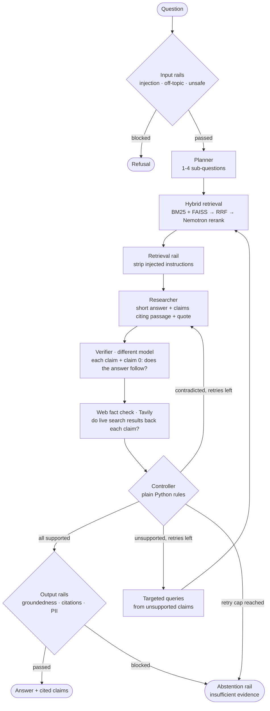

# Self-Correcting RAG

A question-answering system that answers complex, multi-hop questions **only when every claim is backed by
evidence**. It breaks the question down, retrieves evidence with hybrid search, drafts an answer with claim-level
citations, verifies every claim (with a different model and against live web search), and then accepts, searches
again, revises or abstains. NeMo Guardrails protect the input, the retrieved text and the output.

Built on the **NVIDIA NeMo Agent Toolkit** (orchestration), **NeMo Guardrails** (safety) and NVIDIA-hosted
**Nemotron** models.

## How it works



**Controller policy**, checked in this order after each verified draft (no LLM involved, fully unit-tested):

| Situation | Action |
|---|---|
| every claim supported, including claim 0 | accept, then output rails |
| retry cap reached (default 2) | abstain: "insufficient evidence" |
| any claim contradicted | revise the draft, naming the contradicted claims |
| otherwise: unsupported claims, or no claims | retrieve again with the unsupported claims as queries, then redraft |

**Claim 0** is the Verifier's check that the claims, taken together, establish the answer to *this* question.
Without it, drafts made of true but irrelevant claims passed (a similarly named trophy, a different person of the
same name) and the system answered unanswerable questions.

## Components

| Part | Implementation |
|---|---|
| Orchestration | NeMo Agent Toolkit 1.9.0: every component is a registered toolkit function; the Controller is a custom workflow function |
| Planner, Researcher | `nvidia/nemotron-3.5-super-vl-120b-a12b` (thinking off, temperature 0) |
| Verifier | `nvidia/nemotron-3.5-lightning-30b-a3b`, a different model from the Researcher |
| Retrieval | BM25 (`rank_bm25`) + FAISS over `nvidia/nemotron-3.5-embed-1b`, reciprocal rank fusion, `nvidia/llama-nemotron-rerank-vl-1b-v2` |
| Fact check | Tavily Search API: each supported claim is searched on the live web and fuzzy-matched (`rapidfuzz`) against the results; the matching source URL is kept |
| Safety | NeMo Guardrails 0.24.1, Colang 1.0: input, retrieval, output and abstention rails, each switchable. Guardrails runs the flows; the checks inside them are deterministic Python rules |
| Caching | every LLM, embedding, rerank, judge and web-search call cached on disk by hash of (model or query, prompt, params) |
| API / UI | FastAPI service; Streamlit UI that talks only to the API (the NVIDIA key never reaches the UI) |
| Evaluation | RAGAS 0.4 with `nvidia/nemotron-3-ultra-550b-a55b` as a fixed judge (separate from the system's models) |

## Quick start

Full setup, including Windows-specific notes: [setup.md](setup.md).

```powershell
py -3.13 -m venv .venv
.\.venv\Scripts\python.exe -m pip install -r requirements.txt
.\.venv\Scripts\python.exe -m pip install -e . --no-deps
copy .env.example .env          # NVIDIA_API_KEY, TAVILY_API_KEY
.\.venv\Scripts\python.exe scripts/download_data.py
.\.venv\Scripts\python.exe scripts/build_index.py
.\demo.ps1                      # API on :8000, UI on :8501   (or: make demo, with Docker)
```

One question from the command line:

```powershell
.\.venv\Scripts\nat.exe run --config_file configs/system.yml --input "What series did Tom Mandrake collaborate on that was based on a fictional superhero?"
```

API:

```http
POST /ask
{"question": "...", "settings": {"retry_cap": 1, "rails": {"pii": false}, "fact_check": true}}
```

The response carries the answer, an abstained / blocked flag, each claim with its verdict, cited passage, quote and
web check (with the source URL), the per-attempt loop trace (plan, queries, new passages, verdicts, Controller action), the
guardrail log, and latency, token and LLM-call counts.

## Screenshots

Not captured yet. Run `.\demo.ps1`, then add images to `docs/screenshots/` and link them here.

## Data

A frozen subset of **HotpotQA** (distractor setting, validation split), pinned to an exact Hugging Face revision and
versioned by SHA-256 in `data/eval/manifest.json`:

| | test | dev | pilot (from dev) |
|---|---|---|---|
| answerable | 250 | 50 | 14 |
| unanswerable (gold passages removed from the corpus) | 30 | 6 | 2 |
| prompt injection in the question | 12 | 3 | 2 |
| prompt injection in a corpus passage | 12 | 3 | 2 |

The corpus has 3,573 passages: each question's 2 gold + 8 distractor paragraphs, plus 15 poisoned copies carrying
injected instructions. Every adversarial item has a unique canary string, so an injection that works is detectable
in the answer. Prompts are tuned on dev only.

## Results

**The RAGAS evaluation of the final system is still to do.** The numbers below are development checks on the dev
split only, recorded while choosing the design. They are not test results.

Retrieval on 50 dev answerable questions (recall@5): BM25 0.71, dense 0.92, plain RRF 0.77, RRF + local MiniLM
reranker 0.80, **RRF top 30 + hosted Nemotron reranker 0.95** (the chosen setup).

Guardrail rules on clean data: 0 of 3,558 genuine passages and 0 of 351 normal questions flagged; all 15 poisoned
passages and 15 injected questions caught, plus 5 injection phrasings that are not in the dataset's templates.

## Limitations

- **No test-set results yet.** Design decisions rest on a 20-question dev pilot and a 50-question retrieval check,
  which is too small for firm conclusions.
- **The guardrails are deterministic rules.** Injection, off-topic and unsafe detection use regular expressions. They
  generalise to some new phrasings but will miss creative attacks. The dataset's injection templates were written
  by the same project, so injection results will look better than real-world robustness. A hosted NemoGuard
  content-safety model works with the API key but is not wired in; the topic-control model returned errors.
- **The web check is approximate.** It fuzzy-matches the claim against search snippets, so a true claim worded
  differently from every result is "not confirmed" and downgraded, which can cause extra abstentions; a snippet that
  merely repeats the claim's words confirms it. Web sources vary in quality, and HotpotQA's facts date from 2017,
  so the live web may disagree. Search needs network access, a `TAVILY_API_KEY` and free-tier credits (1 per
  claim checked); if Tavily is unavailable, the model's verdict stands. Results are cached, so a repeated question
  reuses the first search; set `cache: false` for fresh results.
- **The Verifier is itself an LLM** and can be wrong both ways. Claim 0's wording was tuned on 20 dev questions;
  it trades some correct answers for fewer wrong ones.
- **Hosted models can change.** Models are pinned by name only, and the Verifier model is a preview release.
  Several listed models returned 404 for this account and were replaced.
- **Cost and speed.** One question takes about 3 to 7 LLM calls and several seconds, and the free-tier rate limits
  apply. Cached re-runs are free, but cached runs say nothing about latency.
- **Exact match is harsh on wording.** Answers such as "since 1736" vs "1736" score 0 even when right.
- **Platform.** Developed on Windows with Python 3.13. The Docker setup and the UI have not yet been run end to end,
  and `requirements.txt` is a Windows lock (the Dockerfile drops `pywin32`).
- **NeMo Guardrails workaround.** In 0.24.1 (Colang 1.0), loading all flows into one config made flows of other
  stages fire, so each stage runs in its own `LLMRails`. The toolkit's own guardrails integration is not used: it
  requires an older Guardrails version that does not install on Windows.

## Project layout

```
configs/        system.yml (the system), llm.yml (models), smoke.yml (connectivity check)
data/           eval/ frozen sets + manifest, processed/ corpus; raw/, index/, cache/ are git-ignored
src/
  functions/    planner, researcher, verifier, fact_checker, retriever, guardrails (toolkit functions)
  workflows/    self_correcting.py (Controller), smoke.py
  guardrails/   config.yml, input/retrieval/output/abstention .co flows, actions.py, rails.py
  retrieval/    bm25, vector (FAISS), fusion (RRF), reranker
  api/          FastAPI app and workflow runner
  ui/           Streamlit app, API client, rendering helpers
  llm.py        cached NVIDIA client + profiler hooks;  websearch.py  Tavily search;  state.py  Pydantic models
eval/           run_eval.py (record outputs), ragas_eval.py (score them)
scripts/        download_data, make_eval_sets, build_index, make_examples, smoke_models
tests/          109 unit tests, no API calls
docker/         Dockerfile, docker-compose.yml
```

Run the tests with `.\.venv\Scripts\python.exe -m pytest -q`.
